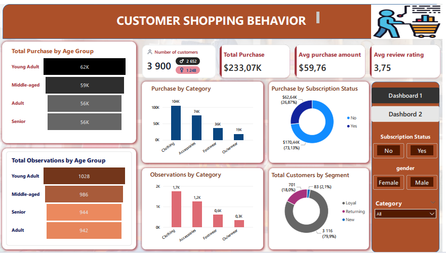
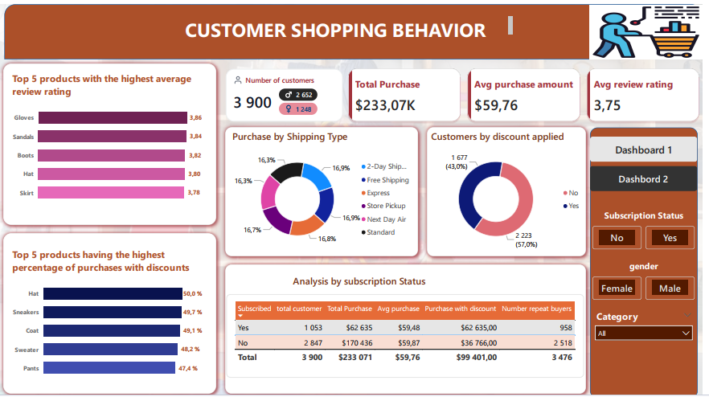
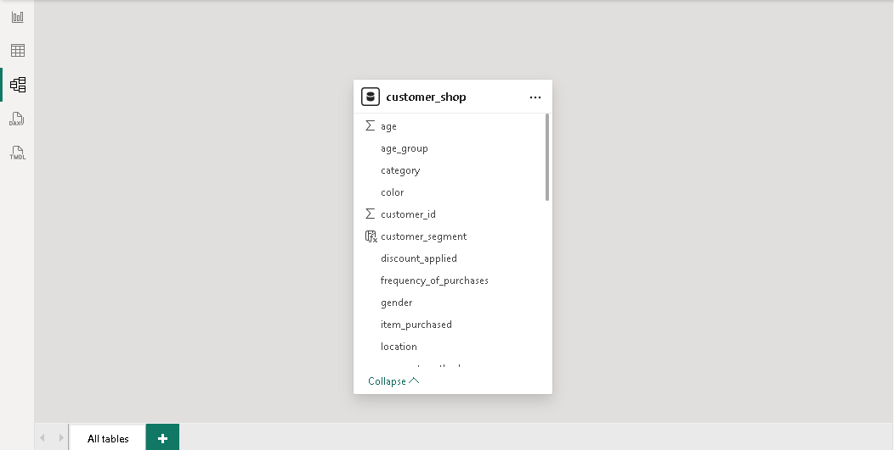

# Analyse des comportements d’achat des clients — Python, SQL Server & Power BI

### Segmentation clients, montants d’achat, satisfaction produits et recours aux remises

**Auteur :** Brice Abogo  
**Spécialisation :** Analyse financière | Comptabilité | Business Intelligence  
**Technologies :** Python / pandas | Microsoft SQL Server / T-SQL | Power Query / M | DAX | Power BI Desktop | Power BI Service



---

## 1. Présentation du projet

Ce projet présente une chaîne de traitement et d’analyse de données consacrée aux comportements d’achat des clients.

Les données sources, disponibles au format CSV, sont d’abord examinées et nettoyées dans Python. Le jeu de données préparé est ensuite chargé dans Microsoft SQL Server, où des requêtes T-SQL permettent d’explorer les comportements d’achat et de calculer les indicateurs analytiques.

Power BI se connecte à la table SQL pour produire un rapport interactif de deux pages. Le rapport est publié dans Power BI Service avec une actualisation planifiée via une passerelle de données locale en mode standard.

Le projet illustre trois compétences complémentaires :

- préparer et contrôler un jeu de données ;
- traduire des questions métier en requêtes SQL et mesures DAX ;
- concevoir et publier une restitution décisionnelle documentée.

## 2. Questions analysées

1. Comment les montants d’achat se répartissent-ils par genre, groupe d’âge et catégorie de produits ?
2. Les clients abonnés présentent-ils un montant moyen d’achat différent de celui des non-abonnés ?
3. Quels produits enregistrent les meilleures notes moyennes ?
4. Quels produits présentent la plus forte proportion d’achats avec remise ?
5. Comment les achats se répartissent-ils selon les modes de livraison ?
6. Quelle est la répartition des clients selon leur nombre d’achats antérieurs ?

## 3. Architecture technique

```text
Fichier CSV source
        │
        ▼
Python / pandas
Contrôle, nettoyage et enrichissement
        │
        ├── Export CSV nettoyé
        │
        ▼
Microsoft SQL Server
Table dbo.customer_shop et analyses T-SQL
        │
        ▼
Power Query / Modèle sémantique / DAX
        │
        ▼
Rapport Power BI Desktop
        │
        ▼
Publication dans Power BI Service
```

Pour l’actualisation dans le Service, la connexion à SQL Server passe par une passerelle de données locale en mode standard.

## 4. Indicateurs affichés dans le rapport

Les valeurs ci-dessous sont relevées dans le rapport fourni, sur son périmètre global. Leur réconciliation avec les fichiers CSV, les requêtes SQL et les mesures DAX sera documentée lors de l’intégration des scripts.

| Indicateur | Valeur |
|---|---:|
| Nombre de clients affiché | 3 900 |
| Montant total des achats | 233 071 USD |
| Montant moyen d’achat | 59,76 USD |
| Note moyenne affichée | 3,75 |

La devise USD provient du libellé de la colonne source `Purchase Amount (USD)`.

Le décompte des clients devra être confirmé par un contrôle des identifiants distincts et non manquants.

## 5. Pages du rapport

### Page 1 — Vue d’ensemble et segmentation

La première page présente :

- les indicateurs globaux ;
- les montants d’achat et les observations par groupe d’âge ;
- la contribution des catégories de produits ;
- la répartition des montants selon le statut d’abonnement ;
- les segments clients définis à partir des achats antérieurs.

La carte HTML du nombre de clients distingue les effectifs masculins et féminins.

### Page 2 — Produits, remises et abonnement

La deuxième page présente :

- le Top 5 des produits selon la note moyenne ;
- le Top 5 des produits selon la proportion d’achats avec remise ;
- la répartition des montants d’achat par mode de livraison ;
- la répartition des clients selon l’application d’une remise ;
- une comparaison détaillée entre abonnés et non-abonnés.



**Navigation et filtres :** navigation entre les deux pages et segments portant sur l’abonnement, le genre et la catégorie de produits.

Les intitulés anglais visibles dans les captures correspondent à la version actuelle du rapport. La documentation du dépôt est rédigée en français.

## 6. Modèle de données

Le modèle repose sur une table analytique unique, `customer_shop`, sans relation intertable dans la version présentée.

Cette table regroupe les attributs clients, les caractéristiques des produits et les informations associées aux observations d’achat. Elle est complétée par des mesures DAX et une colonne calculée de segmentation.



## 7. Publication et actualisation

| Élément | Configuration |
|---|---|
| Plateforme de publication | Power BI Service |
| Passerelle | Passerelle de données locale — mode standard |
| Source d’actualisation | Microsoft SQL Server |
| Horaires configurés | 11 h 30 et 17 h 00 |
| Fuseau horaire | Afrique du Sud — SAST, UTC+02:00 |

L’actualisation planifiée concerne le modèle sémantique Power BI. Elle ne constitue pas une automatisation du nettoyage Python ou du chargement SQL.

Les fichiers disponibles sur GitHub représentent des versions figées du projet.

## 8. Données et limites d’interprétation

- **Format source :** CSV.
- **Origine :** fichier obtenu sur Internet ; adresse exacte non identifiée avec certitude.
- **Licence des données :** non confirmée.
- **Finalité du projet :** pédagogique et démonstrative.
- **Période d’analyse :** non déterminable à partir des colonnes présentées.

Le jeu de données ne comporte pas de date d’achat ni d’identifiant explicite de commande. Les volumes d’observations ne doivent donc pas être assimilés sans réserve à des commandes distinctes.

Les conventions de segmentation, les groupes d’âge et les limites d’interprétation sont détaillés dans la [note méthodologique](documentation/methodologie-et-limites.md).

## 9. Documentation et livrables

- [Méthodologie, conventions et limites](documentation/methodologie-et-limites.md)
- [Captures du rapport et du modèle](images/)
- [Données et résultats du contrôle Python](data/README.md)
- [Préparation des données avec Python](python/README.md)
- [Contrôles et analyses SQL](sql/README.md)
- [Validation croisée Python et SQL Server](documentation/validation-des-donnees.md)
- [Connexion et typage dans Power Query](power-query/README.md)

Les scripts Python, SQL, Power Query et DAX, les fichiers de données et les livrables Power BI seront intégrés progressivement, avec leurs instructions d’utilisation.

